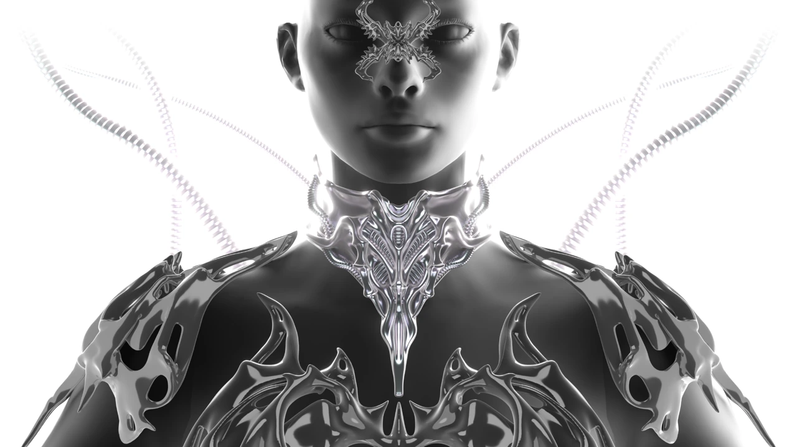
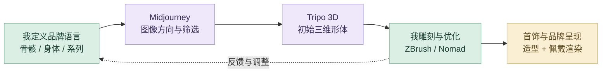
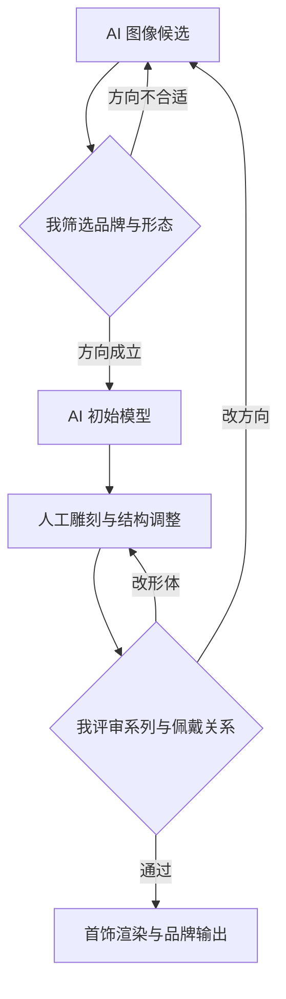
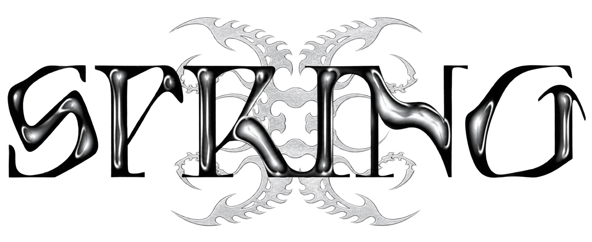
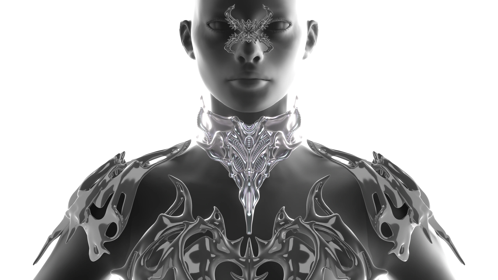

# 骨骸共生系统

SPRING 品牌视觉与骨骸首饰：AI 图像、辅助建模和人工细化。

**[完整设计案例](https://xiongzhiyuan-portfolio.pages.dev/zh/work/bone-series/) · [求职作品总入口](https://github.com/Zhiyuan-Xiong/xiongzhiyuan-portfolio)**

## 项目目标

SPRING 是以 Remake 服装与实验性首饰设计为核心的亚文化服饰品牌。项目期间，我参与品牌视觉设计、Logo 设计以及「骨骸系列（Skeleton Collection）」3D 打印首饰开发，构建从品牌视觉到产品设计的完整创作体系。

## 我的贡献

品牌视觉、Logo 设计与骨骸系列 3D 打印首饰开发

完成阶段：品牌视觉、首饰造型与三维可视化

现有产出：SPRING 字标、品牌视觉、首饰造型与佩戴渲染

## 我的 AI 策略与迭代工作流

用 AI 扩展形态探索，再把视觉方向转成可编辑三维基础。我掌握品牌语言、形体、佩戴关系和细节，专业雕刻承担最终质量控制。

### 从灵感到交付

| 阶段 | AI 策略与我的判断 |
| --- | --- |
| **1. 从品牌定位展开灵感** | 围绕 SPRING 的亚文化定位，把骨骸、金属、身体结构与哥特表达组织成多个造型方向。重点比较这些方向怎样服务品牌与系列产品，而不是单独追求奇特形态。 |
| **2. 检索与个人思维组织** | 整理品牌参考、首饰类型、身体关系与制作要求，形成自己的视觉词汇和判断标准。AI 辅助对话可以扩展候选表达；系列方向与产品取舍由我确定。 |
| **3. 把审美写进图像任务** | 将骨骼形态、材质氛围、佩戴位置、构图与系列一致性转成 Midjourney 的图像探索任务。对候选图进行比较，选择有清晰体块关系、可继续三维发展的方向。 |
| **4. Tripo 3D 建立初始形体** | 将选定图像用于 Tripo 3D，得到可以继续编辑的基础模型。这个环节承担早期形体搭建；图像中的视觉细节仍需要通过人工制作转成合理的结构。 |
| **5. ZBrush 与 Nomad 人工细化** | 进行人工雕刻、形体修正、表面与细节调整，结合佩戴关系、比例和制作需求反复优化。我用专业制作补足初始模型中的形体和结构问题。 |
| **6. 在品牌与产品之间评审** | 把单件首饰与 Logo、品牌视觉和系列其他形态一起检查：语言是否统一，轮廓是否清晰，佩戴关系是否合理。必要时回到图像阶段重新筛选，而不只在原模型上增加装饰。 |
| **7. 反馈重写提示词与方向** | 将问题拆为形体、材质、比例或佩戴关系，再调整图像描述和候选方案。AI 探索与手工雕刻之间允许多次往返，直到视觉表达与产品要求相互支持。 |
| **8. 渲染与系列呈现** | 输出品牌视觉、首饰造型与佩戴渲染，结合系列关系整理成果。当前仓库保存公开渲染与品牌资料；原生模型与原始提示词仍待归档。 |

### 审美、专业制作与质量控制

| 质量维度 | 我如何控制 | 可查看产出 |
| --- | --- | --- |
| **品牌审美** | 把首饰轮廓、材质氛围与 Logo、品牌图像共同评审。 | 统一的 SPRING 系列表达 |
| **三维形体** | 人工调整体块、比例、连接关系和表面细节。 | 经过细化的首饰形态 |
| **产品关系** | 结合身体、佩戴位置和制作需求继续修正。 | 佩戴渲染与产品表达 |

### 反馈如何改变下一步

### 工具分工

Midjourney 用于图像探索；Tripo 3D 用于初始三维形体；ZBrush 与 Nomad 用于人工雕刻。Chat 的作用是辅助整理方向与提示词，Codex 主要参与作品集数字呈现。

**过程证据：** [品牌标识与视觉](media/skeleton/logo.webp) · [佩戴与形体成果](media/skeleton/body-render-white.webp) · [案例职责与章节](case-data.json)

[阅读详细工作流与提示词组织方法](工作流.md) · [我的完整 AI 设计方法](https://github.com/Zhiyuan-Xiong/xiongzhiyuan-portfolio/blob/main/docs/AI设计工作流.md)

## 成果预览

<table><tr><td width="50%"> 品牌标识与视觉表达</td><td width="50%"> 经过形体与细节调整的首饰佩戴渲染</td></tr></table>

## 仓库内容

- [media/](media/)：项目公开影像、图像与交互数据。
- [images/](images/)：作品集封面与不同尺寸展示图。
- [site-source/](site-source/)：对应案例文案、页面组件与相关交互实现。
- [case-data.json](case-data.json)：项目目标、职责、章节与产出信息。

## 查看与使用

GitHub 中可直接浏览图像、GIF、文案与实现文件。完整交互与影像观看入口为顶部的在线案例。网页组件的完整构建环境位于 [作品集总仓库](https://github.com/Zhiyuan-Xiong/xiongzhiyuan-portfolio)。

## 过程证据说明

制作流程：**Midjourney → Tripo 3D → ZBrush／Nomad → 首饰渲染与品牌视觉**。现有文件展示品牌视觉、首饰形态与佩戴渲染；原生模型和提示词尚未归档。

## 署名与使用

作品素材用于个人设计展示。协作项目以案例中的职责说明为准；字体、引擎和第三方资料遵循各自授权。未经许可，不将作品素材用于转载或商业用途。
