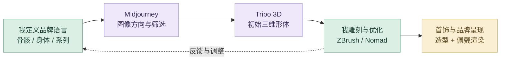
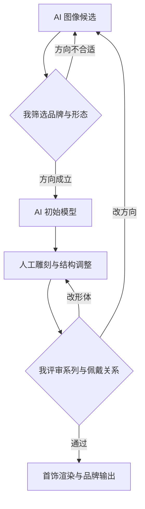

# 骨骸共生系统｜详细 AI 设计工作流

用 AI 扩展形态探索，再把视觉方向转成可编辑三维基础。我掌握品牌语言、形体、佩戴关系和细节，专业雕刻承担最终质量控制。

## 策略图

## 工具怎样分工

Midjourney 用于图像探索；Tripo 3D 用于初始三维形体；ZBrush 与 Nomad 用于人工雕刻。Chat 的作用是辅助整理方向与提示词，Codex 主要参与作品集数字呈现。

## 指令与任务组织

我先用完整的任务说明建立上下文：交代项目目标、参考资料、审美方向、实现约束、输出格式与验收标准，让 ChatGPT 和 Codex 理解要完成什么。得到初步方案或原型后，我再以精准的短指令逐轮控制修改，明确本轮改什么、保留什么，并对照实际结果继续判断。**完整指令建立方向，短指令控制细节，专业判断决定交付。**

## 八阶段输入与输出

| 阶段 | 输入 | AI 协作与我的控制 | 输出与验收 |
| --- | --- | --- | --- |
| **1. 灵感发散** | 骨骼、生长、共生与品牌目标 | Chat 协助展开形态与品牌表达角度；我选择 SPRING 的概念和系列语言 | 概念关键词；判断是否符合品牌 |
| **2. 多渠道检索** | 形态参考、首饰与身体关系 | 归纳参考中的体块与连接特征；我判断审美与佩戴表达的适用性 | 参考与形态条件；核对身体关系 |
| **3. 个人思维组织** | 概念、参考与视觉候选 | 辅助组织图像和产品任务；我定义轮廓、比例、材质与 Logo 关系 | 品牌 brief；确定统一的视觉基准 |
| **4. AI 辅助方案** | brief、参考与图像要求 | Midjourney 探索视觉与形态候选；筛选符合系列气质的图像方向 | 选定参考；未通过则改方向或提示词 |
| **5. 原型实现** | 选定图像与三维目标 | Tripo 3D 建立初始模型；我检查体块、结构和细节基础 | 初始形体；确定需要人工细化的部分 |
| **6. 迭代与测试** | 初始模型与佩戴渲染 | AI 支持方案比较和说明整理；我用 ZBrush／Nomad 调整比例、连接和表面 | 精修造型；评审系列与身体关系 |
| **7. 反馈与再检索** | 形态偏差或系列不一致 | 对话改写下一轮探索要求；方向问题回图像，局部形体问题人工调整 | 新参考或精修模型；对照原基准 |
| **8. 精修与交付** | 确认造型、品牌图像、渲染 | 协助组织系列说明与数字呈现；我核对 Logo、产品与佩戴视觉的一致性 | 首饰与品牌呈现；保留作者职责 |

## 精选决策：区分概念探索与专业精修

Midjourney 帮我扩大图像与形态候选，Tripo 3D 提供初始三维基础。我根据系列审美筛选方向，随后在 ZBrush／Nomad 调整体块、比例、连接与表面细节，让模型进入首饰与身体的关系。

| 评审发现 | 我的控制方式 | 下一步 |
| --- | --- | --- |
| 图像方向不符合品牌语言 | 重新限定骨骼、生长与共生的视觉关系 | 返回图像探索并筛选 |
| 方向成立，局部形体需要细化 | 保留系列方向，在专业软件中调整形体 | ZBrush／Nomad 人工雕刻 |
| 单件与系列或佩戴视觉不协调 | 将产品、身体、Logo 与材质共同评审 | 调整造型与最终呈现 |

以上为作者确认的工具链与设计决策整理；现有证据为品牌和渲染，原生模型与原始提示词后续归档。

## 审美与专业质量

| 质量维度 | 我如何控制 | 可查看产出 |
| --- | --- | --- |
| **品牌审美** | 把首饰轮廓、材质氛围与 Logo、品牌图像共同评审。 | 统一的 SPRING 系列表达 |
| **三维形体** | 人工调整体块、比例、连接关系和表面细节。 | 经过细化的首饰形态 |
| **产品关系** | 结合身体、佩戴位置和制作需求继续修正。 | 佩戴渲染与产品表达 |

## 迭代路线

## 过程证据

[品牌标识与视觉](media/skeleton/logo.webp) · [佩戴与形体成果](media/skeleton/body-render-white.webp) · [案例职责与章节](case-data.json)

[项目总览](README.md) · [完整 AI 设计方法](https://github.com/Zhiyuan-Xiong/xiongzhiyuan-portfolio/blob/main/docs/AI设计工作流.md)
